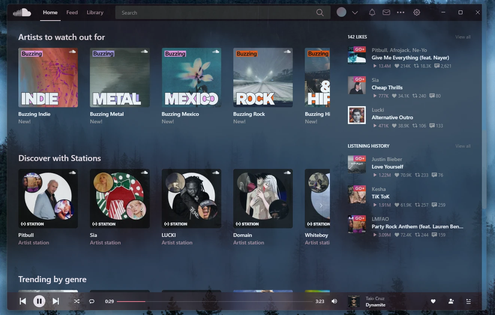
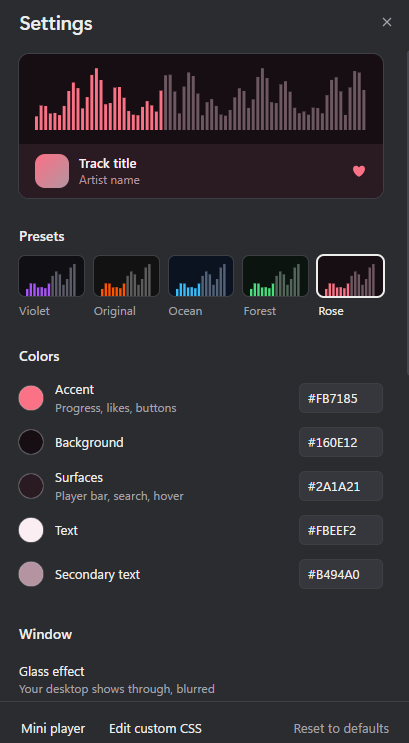

  

<h1 align="center">Sound</h1>

  A SoundCloud desktop player for Windows that you can make your own. 
  Your colors, glass effects, a cleaner page, and full playback including GO+.

  <a href="../../releases/latest"><b>Download for Windows</b></a>

  

## What it does

Sound opens SoundCloud in its own window, so everything you use on the website still works: your playlists, likes, feed, search, and queue. On top of that, you can change how it looks.

- **Your colors.** Pick an accent, background, surfaces, and text colors, or start from one of five presets. A live preview shows the change before you close the settings.
- **Glass.** Turn on Acrylic or Mica so your desktop shows through, blurred, and set how much of the background color covers it.
- **A cleaner page.** Hide ads and artist upsells (Artist Pro, Artist Studio, artist tools, promo banners), the "Get the app" box and footer, who-to-follow suggestions, and the upload button.
- **Nicer lists.** Playlists show the title above the artist, with quiet track numbers and no divider lines.
- **Protected tracks play.** GO+ and major-label tracks work just like in Chrome or Edge.
- **Window extras.** No title bar: the window buttons sit in SoundCloud's top bar. You can also set window opacity, keep the window always on top, switch to a mini player, and pick a font and cover corner radius.
- **Custom CSS** for anything else you want to change.

  

## Install

1. Download `Sound-Setup-x.x.x.exe` from the [latest release](../../releases/latest).
2. Run it. Windows may show **"Windows protected your PC"** because the app isn't code-signed with a paid certificate. Click **More info**, then **Run anyway**.
3. Sign in with your SoundCloud account.

On first start, Sound downloads Google's Widevine module, which it needs for protected tracks. This takes a few seconds and happens once.

## Using it

| | |
|---|---|
| Open settings | Gear icon in the top bar, or `Ctrl` + `,` |
| Reload | `F5` or `Ctrl` + `R` |
| Zoom | `Ctrl` + `+` / `-`, reset with `Ctrl` + `0` |
| Move the window | Drag any empty spot in the top bar |

Every change in settings applies immediately and is saved.

## FAQ

**Do GO+ tracks play?**
Yes, if your account has GO+. Without GO+ you get the same 30-second previews as on the website.

**Does Sound collect any data?**
No. It shows soundcloud.com in a window. The only other thing it connects to is Google's update service, to download the Widevine module. Your settings and login stay on your PC, in `%APPDATA%\soundcloud-player`.

**Why does Windows warn me?**
Getting rid of that warning takes a paid code-signing certificate. The app is still signed for protected playback (Widevine VMP via castLabs), which is a separate kind of signature.

**A part of the page looks off or something came back that I'd hidden.**
SoundCloud changes its website from time to time. Hiding and styling work by recognizing parts of the page, so a SoundCloud update can break them until Sound is updated.

## Credits

- Built on [castLabs Electron](https://github.com/castlabs/electron-releases), an Electron build that includes Widevine.
- Content and playback by SoundCloud.

---

Sound is an unofficial app and is not affiliated with, endorsed by, or connected to SoundCloud. SoundCloud is a trademark of its respective owner.
